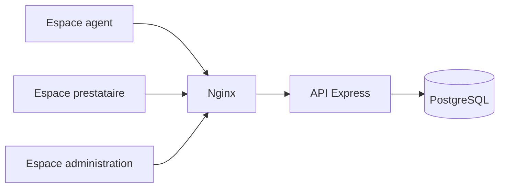

# Atlantide

Espace de **compatibilité entre les agents, les prestataires et l'administration**, pour la Direction interrégionale de la mer Méditerranée.

L'application sépare les espaces par rôle, expose une API et stocke les données dans PostgreSQL. Le frontend et l'API sont servis derrière le même domaine, pour un accès depuis le réseau institutionnel.

<p align="center">
  
  
  
  
  
</p>

<p align="center">
  <strong>Dépôt :</strong> <a href="https://github.com/Meriem1403/Atlantide">github.com/Meriem1403/Atlantide</a>
</p>

---

## Sommaire

- [Présentation](#présentation)
- [Fonctionnalités](#fonctionnalités)
- [Stack technique](#stack-technique)
- [Architecture](#architecture)
- [Prérequis](#prérequis)
- [Installation et développement](#installation-et-développement)
- [Variables d'environnement](#variables-denvironnement)
- [Déploiement](#déploiement)
- [Sécurité](#sécurité)
- [Structure du projet](#structure-du-projet)
- [Scripts disponibles](#scripts-disponibles)

---

## Présentation

Atlantide donne à chaque acteur un espace qui correspond à son rôle :

- **agent** : suivi de son dossier et des échanges avec l'administration ;
- **prestataire** : pièces, factures et informations attendues ;
- **administration** : paramétrage, agents, prestataires et documents.

Les données métier ne sont pas des jeux de démonstration publics. Elles vivent dans la base PostgreSQL de l'environnement concerné.

---

## Fonctionnalités

| Espace | Description |
|--------|-------------|
| **Authentification** | Connexion par rôle, jeton JWT, durée de session configurable |
| **Agents** | Dossiers agents et accès à leur espace |
| **Prestataires** | Fiches prestataires et pièces associées |
| **Administration** | Réglages, utilisateurs et état de l'application |
| **Documents** | Pièces administratives rattachées aux dossiers |
| **Factures et subventions** | Suivi des pièces financières côté administration |
| **Notifications** | Envoi de courriel optionnel (SMTP) vers l'administration |

---

## Stack technique

| Couche | Technologies |
|--------|----------------|
| Frontend | React 18, Vite, Tailwind CSS, Radix UI |
| API | Node.js, Express, JWT |
| Données | PostgreSQL |
| Proxy | Nginx (frontend et API sur le même domaine) |
| Conteneurisation | Docker, Docker Compose |
| Cibles | `docker-compose.prod.yml`, `render.yaml`, `netlify.toml` |

---

## Architecture



Le navigateur ne parle qu'au proxy. L'API et la base ne sont pas exposées directement en production.

---

## Prérequis

- **Docker** et Docker Compose
- **Git**
- **Node.js** 20 et npm, seulement si le frontend est lancé hors Docker

---

## Installation et développement

```bash
git clone https://github.com/Meriem1403/Atlantide.git
cd Atlantide
cp .env.example .env
docker compose up --build
```

| Service | URL locale |
|---------|------------|
| Frontend | http://localhost:5173 |
| API | http://localhost:3000 |
| PostgreSQL | `localhost:5432` |
| Mail de test | http://localhost:8025 |

Le fichier `.env` n'est pas versionné. Renseigner un mot de passe de base et un secret JWT propres à la machine.

---

## Variables d'environnement

Les noms utiles, dans `.env` et `backend/.env.example` :

| Variable | Rôle |
|----------|------|
| `DB_NAME`, `DB_USER`, `DB_PASSWORD` | Connexion PostgreSQL |
| `DB_HOST`, `DB_PORT` | Hôte de la base côté API |
| `JWT_SECRET`, `JWT_EXPIRES_IN` | Signature et durée des jetons |
| `VITE_API_URL`, `FRONTEND_URL`, `FRONTEND_PORT` | Adresse de l'API et du frontend |
| `SMTP_HOST`, `SMTP_PORT`, `MAIL_FROM`, `MAIL_ENABLED` | Courriel, désactivé tant que `MAIL_ENABLED` n'est pas vrai |
| `ADMIN_NOTIFICATION_EMAIL` | Destinataire des notifications |

Aucune valeur réelle n'est committée. Les exemples utilisent des placeholders.

---

## Déploiement

| Fichier | Usage |
|---------|--------|
| `docker-compose.yml` | Développement local |
| `docker-compose.prod.yml` | Frontend, API et Nginx sur un même domaine |
| `nginx/` | Configuration du proxy |
| `render.yaml` | Service web Render |
| `netlify.toml` | Build statique du frontend (`npm ci && npm run build`, dossier `dist`) |

En production, le proxy sert le frontend et relaie `/api` vers Express. La base reste sur le réseau interne du compose.

---

## Sécurité

- Secrets uniquement dans `.env` (base, JWT, SMTP).
- Mots de passe jamais repris d'un exemple.
- Le courriel sortant reste coupé tant que `MAIL_ENABLED` n'est pas activé volontairement.
- Accès par rôle : un agent ne voit pas l'espace administration.

---

## Structure du projet

```
Atlantide/
├── src/app/components/     # Espaces agent, prestataire, administration
├── backend/src/routes/     # auth, agents, providers, invoices, documents
├── nginx/                  # Proxy unique
├── docker-compose.yml
├── docker-compose.prod.yml
├── netlify.toml
└── render.yaml
```

---

## Scripts disponibles

| Commande | Description |
|----------|-------------|
| `npm run dev` | Frontend Vite, hors Docker |
| `npm run build` | Build de production du frontend |
| `docker compose up --build` | Pile complète locale |

---

<p align="center">
  <sub>Direction interrégionale de la mer Méditerranée — compatibilité agents, prestataires et administration. Aucun jeu de données métier dans le dépôt.</sub>
</p>
